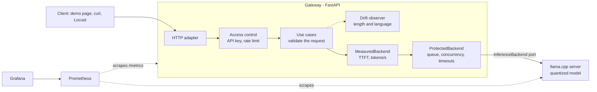

# tokenscope

A low-latency LLM inference service with observability, built to run on modest hardware.

It serves a quantized open-source model behind an OpenAI-compatible API, protects the engine from overload with a bounded queue, and measures every request (time to first token, tokens per second, queue wait) in Prometheus and Grafana. Everything starts with one `docker compose` command and needs no GPU and no paid service.

## What it does
- **OpenAI-compatible chat API** (`/v1/chat/completions`) with streaming (server-sent events), so existing clients work by changing the base URL.
- **Overload protection**: a limited number of requests run at once, a few wait in a queue, the rest are refused immediately with `429`; slow answers time out; a client that disconnects frees its place and stops the generation in the engine.
- **API keys and per-client rate limiting** (token bucket).
- **Observability**: time to first token, generation speed, queue wait, outcomes and rejections as Prometheus metrics, `/health` and `/ready`, and a Grafana dashboard that is already provisioned.
- **Prompt drift detection**: it notices when the length or language of what people send stops looking like the traffic the service was tested with, and publishes a score and an alert. It never stores prompt text.
- **Benchmark**: a Locust load test that compares 1B Q4, 1B Q8 and 3B Q4 under growing concurrency, with a reproducible report.
- **A demo chat page** that shows the service working: streaming, per-answer stats, Stop, live queue state and automatic retry when the service is busy.

## How it works


The gateway is our own code: it decides who gets the engine, measures what happens and talks to the engine through a port, so the engine (llama.cpp today) can be replaced. See [architecture](docs/architecture.md) for the decisions and [requirements](docs/requirements.md) for what was asked and what was verified.

## Quick start
Requirements: Docker.

```
cp .env.example .env
sh scripts/download_model.sh      # ~0.8 GB, saved in ./models
docker compose up -d --build
```

One command starts the whole stack. Everything listens on localhost only:

| Service | URL | What it is |
|---|---|---|
| Demo chat | http://localhost:8000 | A chat page that uses the service |
| Gateway API | http://localhost:8000/docs | Interactive API documentation |
| Grafana | http://localhost:3000 | Dashboard "tokenscope overview" (read-only without login; admin password in `.env`) |
| Prometheus | http://localhost:9090 | Metrics storage and queries |
| Engine | http://localhost:8081 | llama.cpp server, behind the gateway |

Inside Compose, the gateway lets exactly `PARALLEL_SLOTS` requests run at once, the same number of slots the engine has, so those two cannot get out of sync.

To run the gateway outside Docker instead (for development), keep the engine up and:

```
docker compose up -d llama
python -m venv .venv
.venv/Scripts/pip install -r requirements.txt        # Linux/Mac: .venv/bin/pip
.venv/Scripts/python -m uvicorn app.main:app --env-file .env
```

## The demo page
Open http://localhost:8000. Each answer shows how long it took to start and how fast it was written (`TTFT 0.31 s · 14.2 tok/s · 64 tokens`), a pill shows whether the engine is ready and how many slots are busy and requests queued, **Stop** cancels the answer and frees the engine at once, and if the service answers `429` the page waits for the time the server asks and tries again (up to three times). If the service has API keys, paste one in Settings; it is kept only in the page, not stored.

To see the queue work, open the page in two or three tabs and send at the same time. The page is plain HTML and JavaScript modules, with no build step and no dependencies.

## Using the API
```
curl http://localhost:8000/v1/chat/completions \
  -H "Content-Type: application/json" \
  -d '{"messages":[{"role":"user","content":"Say hello."}],"max_tokens":40}'
```

Add `"stream": true` to receive the answer token by token as server-sent events (OpenAI format, ending with `data: [DONE]`). The last chunk before `[DONE]` carries the token usage. If the client disconnects, the generation is stopped in the engine so the slot is freed right away.

```
curl -N http://localhost:8000/v1/chat/completions \
  -H "Content-Type: application/json" \
  -d '{"messages":[{"role":"user","content":"Count to 5."}],"stream":true}'
```

`max_tokens`, `temperature`, `top_p` and `stop` are supported. Errors follow the OpenAI shape (`{"error": {"message", "type", "code"}}`): `400` for invalid input, `401` for a bad key, `429` and `503` when the service is busy, `504` when an answer takes too long. If something breaks after a streamed answer has started, the error arrives as the last event of the stream.

## Access control
Set `API_KEYS` in `.env` (`name:key,name:key`) and every request to `/v1/*` must send `Authorization: Bearer <key>`. Generate a key with `python -c "import secrets; print(secrets.token_urlsafe(32))"`. Keys are kept only as hashes in memory, and a wrong key never spends anyone's rate-limit budget.

| Situation | Answer |
|---|---|
| Missing, malformed or wrong key | `401` with `WWW-Authenticate: Bearer` |
| Client exceeded its rate limit | `429` with `Retry-After` (seconds until the next request is allowed) |

The rate limit is a token bucket per client: `RATE_LIMIT_PER_MINUTE` is the sustained rate and `RATE_LIMIT_BURST` how many requests can arrive at once. Set `RATE_LIMIT_PER_MINUTE=0` to turn it off (for example in load tests). **With `API_KEYS` empty, authentication is off** and everyone shares one anonymous budget; the gateway warns about it on start. The docs, demo page and operational endpoints stay public.

## Overload protection
The engine can only serve a few requests at once, so the gateway decides who gets in:

| Situation | Answer |
|---|---|
| A slot is free | Served right away |
| All slots busy, queue has room | Waits its turn (up to `QUEUE_TIMEOUT_S`) |
| Queue is full | `429` immediately, with `Retry-After` |
| Waited too long in the queue | `503` with `Retry-After` |
| Answer takes longer than `GENERATION_TIMEOUT_S` | `504` (inside the stream as an error event if it already started) |

Limits are set in `.env` (`MAX_QUEUE_SIZE`, `QUEUE_TIMEOUT_S`, `GENERATION_TIMEOUT_S`, and `MAX_CONCURRENT_REQUESTS`, which Compose derives from `PARALLEL_SLOTS`; set it by hand, equal to `PARALLEL_SLOTS`, only when running the gateway outside Docker). A client that disconnects while waiting or generating gives its place back.

With 2 slots and a queue of 2, a burst of 7 simultaneous requests gives 4 answers (2 served at once, 2 after waiting) and 3 immediate `429`s, and the service keeps working afterwards.

## Observability
| Endpoint | Purpose |
|---|---|
| `GET /health` | Liveness: the gateway process is up |
| `GET /ready` | Readiness: the engine has its model loaded (`503` while it is loading or down) |
| `GET /metrics` | Prometheus metrics |

These three need no API key and should not be exposed to the public internet.

| Metric | What it tells you |
|---|---|
| `tokenscope_time_to_first_token_seconds` | Time until the first token arrives (streamed answers), queue wait included |
| `tokenscope_tokens_per_second{stream}` | Generation speed of finished requests |
| `tokenscope_request_duration_seconds{stream}` | Total time per request, queue wait included |
| `tokenscope_queue_wait_seconds` | Time spent waiting for a free slot |
| `tokenscope_requests_total{outcome,stream}` | Requests served: `ok`, `error`, `timeout`, `cancelled` |
| `tokenscope_rejected_requests_total{reason}` | Turned away: `unauthorized`, `rate_limited`, `overloaded`, `queue_timeout`, `invalid_request` |
| `tokenscope_prompt_tokens_total`, `tokenscope_completion_tokens_total` | Token volume |
| `tokenscope_active_requests`, `tokenscope_queued_requests`, `tokenscope_engine_slots` | Live queue state |
| `tokenscope_system_cpu_percent`, `tokenscope_system_memory_used_bytes`, `tokenscope_gateway_memory_rss_bytes` | Machine and gateway resources |
| `tokenscope_prompt_length_chars`, `tokenscope_prompts_total{language}` | Length and detected language of the prompts people send |
| `tokenscope_prompt_drift_score{feature}`, `..._threshold`, `..._ready`, `..._reference_samples`, `..._window_samples` | Prompt drift (see the next section) |

Speed never counts time spent in the queue; streamed speed also leaves out the wait for the first token. A request cancelled by the client before the engine reports its token count is counted by pieces received (about one token each). The engine itself also exposes its own metrics at `http://localhost:8081/metrics`.

### Dashboard
Prometheus scrapes the gateway and the engine every 5 seconds, and Grafana ships with the datasource and the "tokenscope overview" dashboard already provisioned (`grafana/`), so there is nothing to configure. It shows what is happening now (active and queued requests, requests/s, p95 time to first token and duration, tokens/s), then time to first token, generation speed, request duration and queue wait over time, outcomes and rejections, token throughput, slots in use, and CPU/RAM.

Latency panels show p50, p95 and p99 as a single blue ramp (the further into the tail, the lighter). CPU and RAM are read from inside Docker, so they describe the virtual machine that runs the containers, not necessarily the whole host. Percentiles come from histogram buckets, so they are estimates between bucket edges.

## Prompt drift detection
A service can keep answering and still get worse because **people start asking for different things** than it was tested with: much longer prompts raise the time to first token and fill the queue (the benchmark shows that), and a language the model handles worse changes the quality. The latency panels would show the symptom; drift detection points at the cause.

How it works:

- Every valid request is reduced to two coarse features, **length** (five buckets: under 50, 50-149, 150-499, 500-1999, 2000+ characters) and **language**. The text itself is never stored, and neither the saved reference nor any metric contains it.
- The **reference** is the first 100 prompts the service sees (or a saved file, see below). After that, a **window** of the most recent 100 prompts is compared with it, one score per feature, using the Population Stability Index (PSI). Under 0.1 means stable, 0.1 to 0.25 some change, and above the threshold (0.25) a significant change.
- Scores are published as `tokenscope_prompt_drift_score{feature}` once the window is full, and not before: a missing number is more honest than a made-up zero. A Prometheus rule (`prometheus/alerts.yml`) raises `PromptDrift` when a feature stays above the threshold for two minutes, and the dashboard shows the scores, the prompt length and the language mix.
- Compose keeps the reference in a volume, so it survives restarts (the window does not: it starts empty and scores come back when it fills). To learn a new one, delete it and restart: `docker compose exec gateway rm /data/drift-reference.json && docker compose restart gateway`. Outside Compose, set `DRIFT_REFERENCE_FILE`. Settings (`DRIFT_*`) are in `.env.example`.

Try it against a running stack (about ten minutes; it sends normal traffic, then long prompts in Spanish, and waits for the alert):

```
python scripts/drift_demo.py --prometheus http://127.0.0.1:9090 --wait-alert
```

What it printed on the development machine, starting from a fresh reference:

| Moment | Length PSI | Language PSI |
|---|---|---|
| Normal traffic, window full | 0.10 | 0.01 |
| After 26 prompts of the new kind | 0.11 | 1.10 |
| After 50 | 0.31 | 2.62 |
| After 100 (window fully replaced) | 1.08 | 9.01 |

Both features went above the threshold and the alert reached `firing`. Language is the more sensitive signal here, because a language that never appeared in the reference weighs heavily in the score.

Limits you should know about:

- **Only large shifts are detected reliably.** With 100 prompts on each side, PSI has noise of its own. In simulation, with the default settings, about 2% of evaluations raised a false alarm when nothing had changed, and a large shift was caught every time; a moderate shift (about 10 points of traffic moving between neighboring length buckets) was caught in only about a quarter of cases. Do not lower the sample sizes much: with 50 and 50 the false alarms rise above 15%.
- **Language detection is weak on short text.** `langdetect` was wrong on 4 of 15 prompts of 18 to 30 characters, with high confidence ("Say hello." came back as Somali), so anything under 40 characters counts as `unknown`. In a chat where most prompts are short, the language feature sees little; length still works.
- **The reference is whatever came first.** Warm-up requests, tests or a benchmark run at the start become the definition of normal. Check `tokenscope_prompt_drift_reference_samples` and reset it if the first traffic was not representative.
- **It watches the input, not the quality of the output.** It says the traffic no longer looks like the reference, not that answers got worse.
- **Cost:** about 5-7 ms of CPU per request, in the gateway's event loop (measured), plus 0.6 s at startup to load the language profiles. Requests refused for being invalid, unauthorized or rate-limited are not observed; requests turned away for overload are, because they are real demand.
- **The alert has no notification channel.** It is visible in Prometheus (`/alerts`) and as a metric; there is no Alertmanager to send it anywhere.

## Benchmark
Load test with [Locust](https://locust.io) against the full stack, on a laptop CPU (Intel i5-1235U, no GPU), comparing three configurations of Llama 3.2 at 1, 2, 4, 8 and 16 concurrent users. Full tables in [benchmarks/REPORT.md](benchmarks/REPORT.md), raw results in `benchmarks/results/`.


What it shows, for the default engine setup (2 slots):

- **Throughput stops growing at 2 users, the number of slots.** The 1B Q4 model goes from 12.9 to 16.2 tokens/s in total when a second user arrives, then stays flat (16.5, 16.0, 15.9 with 4, 8 and 16). Each request gets slower in exchange: 14.0 tokens/s alone, about 8 with two running.
- **Past that point, extra users only wait.** Time to first token (p95) for 1B Q4: 0.27 s with 2 users, 9.4 s with 4, 26.6 s with 8. Latency follows users divided by throughput, so it grows in a straight line while throughput does not.
- **The protection works under 8x overload.** With 16 users, 94-97% of attempts are turned away, each refusal arrives in 43-53 ms (p95, client side), and the requests that were accepted finish with about the same latency as at 8 users (37 s vs 34 s at p95) instead of degrading further. With the heavier 3B model a few waiting requests exceeded the 30 s queue limit and got a `503` (8 at 8 users).
- **Size matters more than quantization.** 3B Q4 gives about 2.4x less throughput than 1B Q4 (6.7-7.0 vs 16.2-16.5 tokens/s with 2 to 4 users). Q8 instead of Q4 on the 1B model costs 12-28% of throughput for a 1.6x bigger file (1.23 vs 0.75 GiB). This benchmark measures speed, not answer quality: whether Q8 or 3B is worth the cost depends on how good the answers need to be.
- **Sizing the queue is a latency decision.** The default queue (8 waiting, up to 30 s) is generous. To keep, for example, time to first token under 10 s with the 1B Q4 model, allow about 4 users in flight (2 running + 2 queued, `MAX_QUEUE_SIZE=2`) and refuse the rest.

Limits of these numbers: one laptop, one run per level of 60 seconds (5 to 22 successful requests per level, so p99 is close to the slowest request and small differences are noise), configurations always run in the same order, and no repetitions to estimate variance. The machine was also **not otherwise idle**: unrelated Docker containers (a database and an Airflow scheduler, among others) were running during the runs, and the scheduler alone was seen using between 4% and 90% of a core. In short, isolated requests earlier in development the 1B Q4 model reached about 30 tokens/s; here it gives about 14 per request under sustained load. That gap probably has several causes (the competing containers, a laptop CPU under sustained load, the Docker network path, 64-token answers) and I have not separated them, so treat absolute speeds as indicative and the shape of the curves as the result. Peak memory was not measured reliably (`docker stats` does not count memory-mapped model files); the weights themselves are 0.75 to 1.9 GiB.

To reproduce it:

```
sh scripts/download_benchmark_models.sh     # ~4.1 GB
pip install -r requirements-bench.txt
python benchmarks/run_benchmark.py          # about 30 minutes, restarts the engine for each model
python benchmarks/analyze.py                # writes REPORT.md, benchmark.png and summary.csv
```

The load is closed-loop: each simulated user sends a streamed request, waits for the whole answer and sends the next, honoring `Retry-After` when turned away. Use `127.0.0.1`, not `localhost`, when measuring from Python on Windows: `localhost` resolves to IPv6 first and every new connection then waits about 2 seconds for the refused attempt.

## Design
Hexagonal architecture, kept light: the domain and application layers never import a web or HTTP library, so queueing, limits and measurement are tested against a fake engine with no model. The engine sits behind an `InferenceBackend` port; queueing and measurement are decorators around it. There is no DDD (the domain is a request, a queue and a limit, too small to need it) and patterns are used only where they solve something. The reasoning is in [docs/architecture.md](docs/architecture.md).

## Tests
No model needed: the Python tests use a fake backend and the JavaScript tests cover the demo's pure logic.

```
.venv/Scripts/pip install -r requirements-dev.txt
.venv/Scripts/python -m pytest
node --test "tests/js/*.test.mjs"
```

The benchmark analysis tests run when `matplotlib` is installed (`requirements-bench.txt`) and are skipped otherwise.

## Project layout
```
app/
  domain/         request model and limits (no I/O)
  application/    use cases, ports, access control, drift detection, and the queue and measurement decorators
  adapters/
    inbound/      FastAPI: HTTP, server-sent events, demo page
    outbound/     llama.cpp client, Prometheus metrics, token bucket, language detector, reference file
demo/             chat page: plain HTML and JavaScript modules
benchmarks/       Locust load test, runner, analysis, report and raw results
grafana/          provisioned datasource and dashboard (and the script that generates it)
prometheus/       scrape configuration and the drift alert rule
scripts/          model downloads and the drift demo
tests/            Python tests (fake backend) and tests/js for the demo logic
docs/             requirements and architecture
```

## Known limits and what is not done
- Prompt drift detection only reliably catches large shifts and is blind to language on short prompts (see its section).
- Rate limits live in memory: they reset with the process and are not shared between replicas. The service is meant to run as a single node.
- The only engine adapter is llama.cpp on CPU. The port makes a vLLM or GPU adapter possible, but none has been written or tested.
- Authentication is off until `API_KEYS` is set, and `/metrics`, `/health` and `/ready` are always public.
- Benchmark numbers come from one laptop, with no repeated runs (see the benchmark section).
