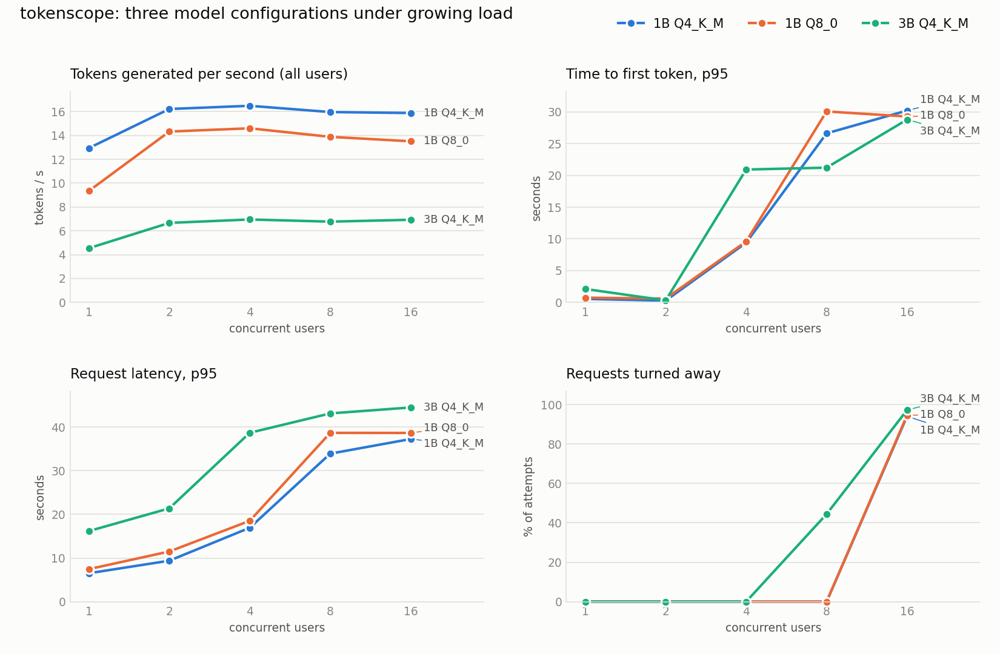

# Benchmark report

_Generated by `benchmarks/analyze.py` from the raw results in `benchmarks/results/`._

**Machine:** Intel Core i5-1235U (10 cores, 12 threads), 16 GB RAM, no dedicated GPU. Docker Desktop with 12 CPUs and 8 GB; engine with 2 parallel slots, 6 threads, 4096-token context.

**Load:** closed loop. Each simulated user sends a streamed request, waits for the whole answer and sends the next one (users honor `Retry-After` when turned away). Every answer asks for 64 tokens at temperature 0; about 1 prompt in 17 is a longer one (a few hundred tokens). The gateway keeps its production limits: 2 running, 8 queued, 30 s maximum wait in the queue. Per-client rate limiting is off.

**How to read it:** time to first token (TTFT) and latency include the time a request spent waiting in the queue, because that is what a client experiences. Percentiles use only successful requests; `n` is how many there were, and with fewer than 100 the p99 is close to the slowest request. Speed is tokens per second of one request after its first token. `429` means the queue was full; `503` means the request waited more than the maximum time in the queue. Turned-away users retry after the `Retry-After` the server sends, so at 16 users the share of refused attempts is inflated by those retries. With so few requests per level, small differences (especially time to first token at 1 and 2 users, which mostly reflects whether a long prompt happened to be in the sample) are noise.

## 1B Q4_K_M

| Users | n ok | Turned away | 429 answered in (p95) | Timeouts | Other errors | Tokens/s (all) | Speed per request (tok/s) | TTFT p50 / p95 / p99 (s) | Latency p50 / p95 / p99 (s) |
|---:|---:|---:|---:|---:|---:|---:|---:|---|---|
| 1 | 13 | 0 | - | 0 | 0 | 12.9 | 14.0 | 0.12 / 0.54 / 0.54 | 4.66 / 6.51 / 6.81 |
| 2 | 16 | 0 | - | 0 | 0 | 16.2 | 8.3 | 0.19 / 0.27 / 0.28 | 7.81 / 9.39 / 9.42 |
| 4 | 19 | 0 | - | 0 | 0 | 16.5 | 8.8 | 7.50 / 9.38 / 9.44 | 14.62 / 16.94 / 17.53 |
| 8 | 22 | 0 | - | 0 | 0 | 16.0 | 8.3 | 23.72 / 26.62 / 26.64 | 31.70 / 33.92 / 33.93 |
| 16 | 22 | 346 x 429 + 4 x 503 (94%) | 43 ms | 0 | 0 | 15.9 | 8.4 | 23.98 / 30.20 / 30.37 | 31.51 / 37.27 / 37.39 |

## 1B Q8_0

| Users | n ok | Turned away | 429 answered in (p95) | Timeouts | Other errors | Tokens/s (all) | Speed per request (tok/s) | TTFT p50 / p95 / p99 (s) | Latency p50 / p95 / p99 (s) |
|---:|---:|---:|---:|---:|---:|---:|---:|---|---|
| 1 | 9 | 0 | - | 0 | 0 | 9.3 | 9.8 | 0.55 / 0.74 / 0.77 | 7.06 / 7.46 / 7.50 |
| 2 | 14 | 0 | - | 0 | 0 | 14.3 | 7.6 | 0.15 / 0.59 / 0.60 | 8.38 / 11.50 / 11.50 |
| 4 | 16 | 0 | - | 0 | 0 | 14.6 | 7.2 | 8.96 / 9.59 / 9.59 | 17.84 / 18.53 / 18.53 |
| 8 | 20 | 0 | - | 0 | 0 | 13.9 | 7.5 | 27.38 / 30.07 / 30.52 | 37.07 / 38.68 / 38.71 |
| 16 | 20 | 344 x 429 + 6 x 503 (95%) | 53 ms | 0 | 0 | 13.5 | 7.1 | 24.43 / 29.27 / 29.33 | 33.71 / 38.67 / 38.79 |

## 3B Q4_K_M

| Users | n ok | Turned away | 429 answered in (p95) | Timeouts | Other errors | Tokens/s (all) | Speed per request (tok/s) | TTFT p50 / p95 / p99 (s) | Latency p50 / p95 / p99 (s) |
|---:|---:|---:|---:|---:|---:|---:|---:|---|---|
| 1 | 5 | 0 | - | 0 | 0 | 4.5 | 5.4 | 1.43 / 2.11 / 2.12 | 13.68 / 16.18 / 16.56 |
| 2 | 8 | 0 | - | 0 | 0 | 6.7 | 3.4 | 0.29 / 0.31 / 0.31 | 18.73 / 21.38 / 21.38 |
| 4 | 10 | 0 | - | 0 | 0 | 7.0 | 3.5 | 17.92 / 20.92 / 20.92 | 35.53 / 38.70 / 38.71 |
| 8 | 10 | 8 x 503 (44%) | - | 0 | 0 | 6.8 | 3.3 | 16.83 / 21.21 / 21.21 | 35.69 / 43.14 / 43.14 |
| 16 | 10 | 343 x 429 + 12 x 503 (97%) | 51 ms | 0 | 0 | 6.9 | 3.5 | 18.77 / 28.78 / 28.78 | 37.14 / 44.50 / 44.50 |

## Side by side

**Tokens per second, all users together**

| Users | 1B Q4_K_M | 1B Q8_0 | 3B Q4_K_M |
|---:|---:|---:|---:|
| 1 | 12.9 | 9.3 | 4.5 |
| 2 | 16.2 | 14.3 | 6.7 |
| 4 | 16.5 | 14.6 | 7.0 |
| 8 | 16.0 | 13.9 | 6.8 |
| 16 | 15.9 | 13.5 | 6.9 |

**TTFT p95 (s)**

| Users | 1B Q4_K_M | 1B Q8_0 | 3B Q4_K_M |
|---:|---:|---:|---:|
| 1 | 0.54 | 0.74 | 2.11 |
| 2 | 0.27 | 0.59 | 0.31 |
| 4 | 9.38 | 9.59 | 20.92 |
| 8 | 26.62 | 30.07 | 21.21 |
| 16 | 30.20 | 29.27 | 28.78 |

**Latency p95 (s)**

| Users | 1B Q4_K_M | 1B Q8_0 | 3B Q4_K_M |
|---:|---:|---:|---:|
| 1 | 6.5 | 7.5 | 16.2 |
| 2 | 9.4 | 11.5 | 21.4 |
| 4 | 16.9 | 18.5 | 38.7 |
| 8 | 33.9 | 38.7 | 43.1 |
| 16 | 37.3 | 38.7 | 44.5 |

**Speed of one request (tokens/s)**

| Users | 1B Q4_K_M | 1B Q8_0 | 3B Q4_K_M |
|---:|---:|---:|---:|
| 1 | 14.0 | 9.8 | 5.4 |
| 2 | 8.3 | 7.6 | 3.4 |
| 4 | 8.8 | 7.2 | 3.5 |
| 8 | 8.3 | 7.5 | 3.3 |
| 16 | 8.4 | 7.1 | 3.5 |

## Memory

The weights have to be resident to generate, so the model file size is the reliable floor for each configuration. The `docker stats` column is **not** a footprint: llama.cpp memory-maps the model and `docker stats` does not count those file-backed pages, so it understates (it even shows the larger Q8 file as using less than Q4). It is kept only as a record of what that tool reports.

| Configuration | Model file (the weights) | Engine, `docker stats` | Gateway |
|---|---|---|---|
| 1B Q4_K_M | 0.75 GiB | 0.66 GiB | 38 MiB |
| 1B Q8_0 | 1.23 GiB | 0.22 GiB | 37 MiB |
| 3B Q4_K_M | 1.88 GiB | 2.13 GiB | 39 MiB |

