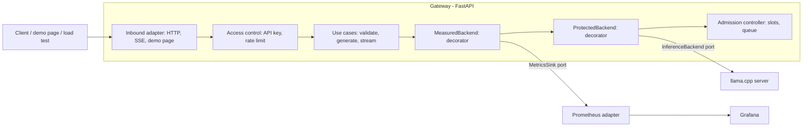

# Architecture

## Overview



The gateway is our own code: queueing, concurrency limits, streaming, API keys, rate limiting and measurement. The inference engine is only a replaceable component behind a port.

## Layout

```
app/
  domain/          pure rules: chat request, generation parameters, request limits
  application/     use cases, access control, admission control, the two decorators
    ports/         InferenceBackend, MetricsSink, RateLimiter
  adapters/
    inbound/       FastAPI (HTTP, server-sent events, demo page)
    outbound/      LlamaCppBackend, PrometheusMetrics, TokenBucketRateLimiter
  config.py, main.py   configuration from the environment and the wiring of everything
```

Rules (enforced by `tests/test_architecture.py`):

- `domain` and `application` import no web or I/O library (FastAPI, httpx, Prometheus client, psutil...).
- `domain` imports nothing else of ours; `application` does not know the adapters.
- The inbound and outbound adapters do not know each other. Only `main.py` wires them together.

Tests for the queue, the limits and the measurement run against a `FakeBackend` that can hold requests, add latency, fail or break mid-stream, so overload is tested deterministically and without a model.

## How a request travels

1. The HTTP adapter authenticates the caller and checks its rate-limit budget (`AccessControl`).
2. The use case applies the defaults and validates the request against the limits. Invalid input never reaches the engine.
3. `MeasuredBackend` starts its clock, then `ProtectedBackend` asks the `AdmissionController` for a slot: it runs, waits in the queue, or is refused.
4. The `LlamaCppBackend` adapter streams the answer from the engine. Closing the stream (the client left, a timeout, or a normal end) closes the connection to the engine, which stops generating.
5. `MeasuredBackend` reports one sample to the `MetricsSink`: outcome, duration, time to first token, tokens, and how long it waited in the queue.

For streamed answers, the HTTP adapter asks for the first piece before it sends any header, so an invalid request or an overloaded service still gets a proper `400` or `429`. Errors after that point travel as an event inside the stream.

## Decisions

**Hexagonal (ports and adapters), lightweight.** The engine must be swappable (llama.cpp, Ollama, vLLM, hosted APIs). That is exactly a port with adapters, and it also makes overload behavior testable without a model.

**No DDD.** The domain is small (a request, a queue, a limit). Aggregates, domain events and bounded contexts would add ceremony without solving a problem. We keep clear domain names and simple value objects.

**Design patterns, only where they solve something.**

| Pattern | Where | Why |
|---|---|---|
| Port / Adapter (Strategy) | `InferenceBackend`, `MetricsSink`, `RateLimiter` | Swap the engine, the metrics system or the limiter |
| Bounded queue + semaphore | `AdmissionController` | Limit concurrency, refuse the excess quickly |
| Decorator | `ProtectedBackend`, `MeasuredBackend` | Add protection and measurement without mixing them into the engine adapter or each other |
| Token bucket | `TokenBucketRateLimiter` | Per-client rate limit that allows short bursts |
| Factory | `build_backend`, `build_rate_limiter` in `main.py` | Choose the implementation from configuration |
| Null object | `NullMetrics`, `UnlimitedRateLimiter` | Turn a feature off without `if` checks in the callers |

No Repository or Unit of Work: there is no persistence.

## Trade-offs worth knowing

- **Measure outside the protection.** `MeasuredBackend` wraps `ProtectedBackend`, so durations and time to first token include the wait in the queue: that is what the client experiences. The wait is also reported separately, so generation speed can be computed without it. The admission controller hands the wait to the measuring layer through a `ContextVar`, because both run in the task that serves the request. That avoids changing the port, at the cost of a hidden channel between two classes; the tests that combine both decorators exist for that reason.
- **State is in memory.** The queue and the rate-limit buckets live in the process. That is simple and fast, and it limits the service to one node.
- **One engine adapter.** The port is real, but only llama.cpp is implemented, so how well it fits an engine with a different streaming or cancellation behavior is untested.
