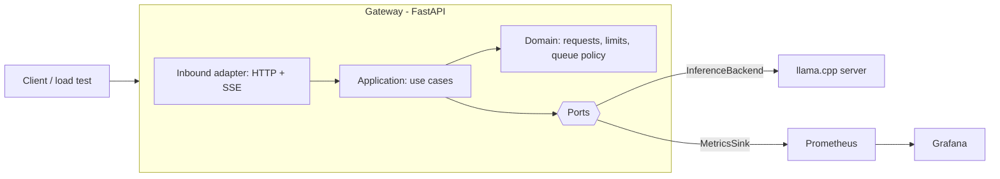

# Architecture

## Overview



The gateway is our own code: queueing, concurrency limits, streaming, API keys, rate limiting and measurement. The inference engine is only a replaceable component behind a port.

## Layout

```
app/
  domain/          pure rules: request, limits, queue policy
  application/     use cases (generate, measure, reject)
    ports/         InferenceBackend, MetricsSink, RateLimiter
  adapters/
    inbound/       FastAPI (HTTP, SSE)
    outbound/      LlamaCppBackend, PrometheusMetrics, ...
```

Rule: `domain` and `application` never import FastAPI, `httpx` or any I/O library. Tests for the queue and the policies run against a `FakeBackend` that simulates latency.

## Decisions

**Hexagonal (ports and adapters), lightweight.** The engine must be swappable (llama.cpp, Ollama, vLLM, hosted APIs). That is exactly a port with adapters, and it also makes overload behavior testable without a model.

**No DDD.** The domain is small (a request, a queue, a limit). Aggregates, domain events and bounded contexts would add ceremony without solving a problem. We keep clear domain names and simple value objects.

**Design patterns, only where they solve something.**

| Pattern | Where | Why |
|---|---|---|
| Port / Adapter (Strategy) | `InferenceBackend` | Swap the engine |
| Bounded queue + semaphore | Concurrency control | FR5, FR6 |
| Decorator | Measurement around the backend | Capture TTFT and tokens/s without mixing it into the logic |
| Token bucket | Rate limit | FR8 |
| Factory | Choose the backend from configuration | FR16 |

No Repository or Unit of Work: there is no complex persistence.
